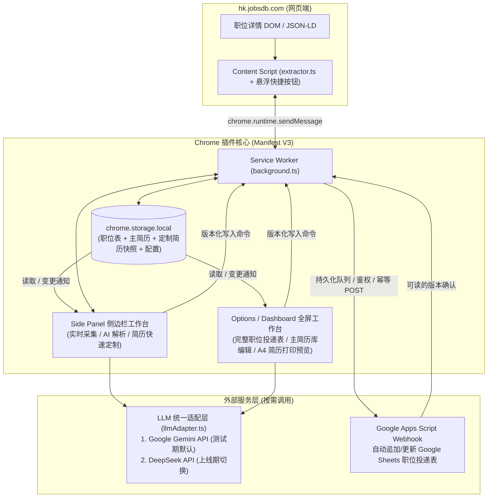

# 技术规格说明书（Spec.md）：香港 JobsDB 求职助手 Chrome 插件

## 一、系统架构设计

采用 **Chrome Extension Manifest V3 + 本地存储优先（Local-First） + 可选云端 Webhook 同步 + 多模型适配器（Gemini / DeepSeek）** 架构：



---

## 二、目录结构规划

```text
/path/to/jobsdb-companion/
├── 需求排期/
│   └── 01_JobsDB求职助手/
│       ├── 产品需求.md
│       ├── [AI读]代码现状快照.md
│       └── Spec.md
├── public/
│   └── icons/
│       ├── icon-16.png
│       ├── icon-48.png
│       └── icon-128.png
├── src/
│   ├── manifest.ts                 # Manifest V3 配置定义
│   ├── types/
│   │   └── schema.ts               # 核心数据结构（岗位、投递表、主简历、定制简历、AI 配置）
│   ├── services/
│   │   ├── storage.ts              # 统一写入、版本检查、容量与备份恢复
│   │   ├── llmAdapter.ts           # Gemini 与 DeepSeek 双引擎统一接口与 JSON 校验
│   │   ├── prompts.ts              # JD 提炼与针对性简历改写 System Prompts
│   │   └── googleSheetsSync.ts     # 持久化同步队列、协议及 GAS 模板
│   ├── content/
│   │   └── jobsdbExtractor.ts      # JobsDB 列表分栏与独立页 DOM/JSON-LD 提取器 + 页面悬浮按钮
│   ├── background/
│   │   └── serviceWorker.ts        # SidePanel 行为注册、跨页面消息转发
│   ├── sidepanel/                  # 侧边栏单岗位操作台（提取 -> 入表 -> 定制简历）
│   │   ├── index.html
│   │   ├── main.tsx
│   │   └── SidePanelApp.tsx
│   └── dashboard/                  # 全屏工作台（多职位投递表管理 + 主简历维护 + A4 简历预览打印）
│       ├── index.html
│       ├── main.tsx
│       ├── DashboardApp.tsx
│       └── components/
│           ├── JobTrackerTable.tsx
│           ├── MasterResumeEditor.tsx
│           ├── ResumePrintPreview.tsx
│           └── SettingsModal.tsx
├── package.json
├── tsconfig.json
└── vite.config.ts
```

---

## 三、核心数据模型（实现约束）

所有数据保存 schemaVersion。下列为关键契约，实际运行时须执行结构校验，不能仅依赖 TypeScript 泛型。

```typescript
export type ApplicationStatus =
  'saved' | 'applied' | 'interviewing' | 'offer' | 'rejected';
export type SyncStatus = 'unconfigured' | 'pending' | 'syncing' | 'synced' | 'failed';

export interface SheetCategory {
  id: string; // UUID，名称不参与关联
  name: string;
}

export interface RequirementEvidence {
  value: string; // 未写明时为“未注明”
  quotes: string[]; // JD 中实际出现的原文，程序检查可定位
}

export interface JobSnapshot {
  source: 'jobsdb';
  sourceJobId: string;
  jobKey: string; // jobsdb:<sourceJobId>
  title: string;
  company: string;
  location: string | null;
  salary: string | null;
  workType: string | null;
  jobUrl: string;
  jdRawText: string;
  jdParagraphs: string[];
  capturedAt: string;
}

export interface JobApplicationRecord {
  id: string; // UUID，远端幂等键，与 jobKey 分开
  categoryId: string;
  job: JobSnapshot;
  analysis?: {
    visa: RequirementEvidence;
    languages: RequirementEvidence[];
    coreKeywords: string[];
    matchScore?: number; // 0～100，仅参考
    matchAnalysis?: string;
    masterResumeVersion: number;
    jdHash: string;
    provider: LLMProviderType;
    model: string;
  };
  status: ApplicationStatus;
  latestTailoredResumeId?: string; // 简历存在与否独立于投递进度
  revision: number; // 每次业务变更递增，含同步列中的分类名称变化
  sync: {
    targetId?: string;
    status: SyncStatus;
    syncedRevision?: number;
    lastError?: string;
    lastSyncedAt?: string;
  };
  notes: string;
  createdAt: string;
  updatedAt: string;
}

export interface ResumeBullet { id: string; text: string; }
export interface ExperienceItem {
  id: string;
  companyOrOrg: string;
  role: string;
  location: string;
  period: string;
  bullets: ResumeBullet[];
}
export interface EducationItem {
  id: string;
  school: string;
  degree: string;
  period: string;
  details: string;
}
export interface MasterResume {
  id: string;
  version: number;
  updatedAt: string;
  fullName: string;
  phone: string;
  email: string;
  location: string;
  linkedinOrPortfolio: string;
  visaStatus: string;
  defaultSummary: string;
  skills: string[];
  languages: string[];
  experiences: ExperienceItem[];
  projects: ExperienceItem[];
  education: EducationItem[];
}

// 模型只返回选择和改写建议，不返回可直接覆盖 MasterResume 的对象。
export interface TailoringSuggestion {
  summary: { text: string; sourceIds: string[] };
  experiences: {
    sourceExperienceId: string;
    bullets: { sourceBulletIds: string[]; text: string }[];
  }[];
  projects: {
    sourceExperienceId: string;
    bullets: { sourceBulletIds: string[]; text: string }[];
  }[];
  orderedSkills: string[]; // 必须属于原有 skills
}

export interface TailoredResume {
  id: string;
  parentResumeId?: string; // 历史编辑另存新版本
  applicationId: string;
  jobSnapshot: JobSnapshot;
  masterResumeVersion: number;
  sourceProfile: MasterResume; // 保留原始事实用于对照
  suggestion?: TailoringSuggestion;
  renderedProfile: MasterResume; // 完整最终数据，包括人工修改及联系方式、教育等
  language: 'en' | 'zh-HK' | 'zh-CN';
  layout: {
    templateVersion: string;
    fontVersion: string;
    hiddenItemIds: string[];
    orderedItemIds: string[];
    pageBreakBeforeIds: string[];
  };
  generation?: { provider: LLMProviderType; model: string; promptVersion: string };
  reviewedAt: string;
  createdAt: string;
}

export type LLMProviderType = 'gemini' | 'deepseek';
export interface ExtensionSettings {
  activeProvider: LLMProviderType;
  gemini: { apiKey: string; model: string };
  deepseek: { apiKey: string; model: string; baseUrl: 'https://api.deepseek.com' };
  googleSheets: {
    enabled: boolean;
    targetId: string; // 与目标工作表配对；更换目标时新建
    webhookUrl: string;
    sharedSecret: string;
  };
}

export interface SyncTask {
  requestId: string;
  targetId: string;
  recordId: string;
  revision: number;
  payload: SheetRowPayload; // 本次版本的不可变投影，不含简历和密钥
  attempts: number;
  nextAttemptAt: string;
}
export interface SheetRowPayload {
  categoryId: string;
  categoryName: string;
  job: JobSnapshot;
  status: ApplicationStatus;
  hasTailoredResume: boolean;
  notes: string;
  createdAt: string;
  updatedAt: string;
}
```

同一 categoryId + jobKey 只能有一条投递记录。跨分类允许不同记录 ID。同表重复采集只定位并提示已有记录；更新岗位快照必须显式确认，不覆盖备注、状态或历史简历。分类改名保留 ID，并为相关记录递增 revision、重新生成同步任务。

## 四、存储、并发与恢复

- Manifest 显式声明 storage、sidePanel、alarms 及必要的站点权限；Content Script 仅匹配 JobsDB。实施阶段记录 Chrome 最低版本、提取注入方式和生产构建路径，验证 CSP 下打包脚本与本地图标可用。
- Service Worker 是业务写入唯一入口。Side Panel／Dashboard 可读数据和订阅变更，通过消息发送带 expectedRevision 的命令；冲突返回最新版本，禁止无条件覆盖。
- 使用串行命令队列；首期将业务状态与 outbox 放在一个版本化根对象中，通过一次 storage.local.set 提交，成功后才回复保存成功。实现时验证失败恢复边界，不把多次 set 当成事务。
- 同步状态更新不递增业务 revision，也不得覆盖较新的业务数据。远端确认后只修改对应目标／版本的同步元数据。
- 启动后从持久化状态重建队列，syncing 但未确认的任务按幂等协议恢复；不依赖内存队列或 setInterval 常驻。启动、连接恢复、手动补推和 chrome.alarms 驱动有限批次处理。
- storage.local 默认配额按 10 MB 设计，使用 getBytesInUse 展示容量，达到 80% 时提示备份。捕获配额／写入失败，保留表单内容，不显示已保存；不自动清理数据。根对象写放大与容量是首期边界，规模不适用时另行评估 IndexedDB。
- storage.local 设置 TRUSTED_CONTEXTS；Content Script 只负责采集，不接触主简历、Key 或共享密钥。消息校验发送者、操作类型及数据结构；不提供任意 URL 请求代理。
- JSON 备份采用字段白名单，包含 schemaVersion、分类、职位记录、主简历、全部定制简历及模板版本引用；不导出设置、密钥、outbox 或远端确认状态。CSV 仅为职位表导出；CSV／Sheets 写入均按文本处理，避免岗位文本被解析成公式。
- 恢复先校验 schema、ID 唯一性、关联完整性及容量，展示预览。仅接受空业务数据集；非空时拒绝覆盖并说明本期不支持合并，不自动清空。恢复后所有记录为 unconfigured，配置目标后重新排队。
- schema 迁移先保留可恢复原数据，迁移失败保持旧版可读；不执行静默破坏性迁移。当前没有历史数据，首版从 schemaVersion=1 开始。

## 五、Google Sheets 协议

### 1. 接入和数据方向

GAS 避免首期 chrome.identity 接入，但仍需 Google 授权、Web App 部署及请求鉴权。部署指引明确以拥有者身份运行、访问范围、正式 /exec URL、共享密钥配置与重新部署步骤。组织策略可能限制匿名部署，不保证所有账号可用。

一个目标对应一张固定明细工作表，以分类列区分本地分类，不为每个分类建远端工作表。GAS 配置固定 spreadsheetId 和工作表，客户端不能指定任意表。目标初始化时创建 targetId 并与扩展配对；更换目标或密钥时中止旧在途任务的本地确认处理，按新配置恢复同步。更换目标必须重新排队，不能继承旧目标的已同步状态。

本地单向推送，Sheets 管理列由插件拥有，远端编辑不回写。同步投影见 SheetRowPayload；不发送 AI 分析、简历正文、联系方式配置或模型 Key。SheetRowPayload 中 hasTailoredResume 只反映已保存版本，不改变投递状态。

### 2. 请求、幂等与确认

- 从扩展受信上下文发起可读响应的 POST；禁止以 no-cors、fetch resolve 或仅 HTTP 200 判定业务成功。允许官方 GAS 域名及其内容服务重定向，其他地址拒绝。
- 请求体：`{ protocolVersion: 1, targetId, sharedSecret, requestId, recordId, revision, payload }`。共享密钥只随 HTTPS 请求发送，不放在 URL、职位行或日志中，GAS 从 Script Properties 读取并比对。
- 服务端先校验鉴权、目标、schema、字段长度及请求大小。使用 LockService 脚本锁包裹查找／写入／flush；以 recordId 查找行，将 recordId 和 revision 与字段同次写入。
- 首次记录新增一行；已有记录只接受更高 revision。相同 revision + 相同 payload 返回幂等确认；相同 revision 不同内容返回冲突；较旧 revision 不覆盖远端。远端保留 payloadHash 用于识别版本内容冲突，哈希由规范化投影计算。
- 成功响应：`{ ok: true, targetId, requestId, recordId, appliedRevision, payloadHash }`；失败响应：`{ ok: false, code, retryable }`。GAS 即使返回 HTTP 200，也必须检查业务字段。
- 客户端核对目标、请求、记录、版本及哈希。只在确认版本等于当前本地 revision 且投影一致时显示 synced；旧响应不能清除新版本的 pending。服务端版本高于本地时显示冲突，不自动回退或覆盖。
- 请求超时不能推断服务端没有写入，复用同一任务重试；服务端已写入但确认丢失时不得重复行。锁失败、网络异常等最多自动尝试 5 次，指数退避并加入抖动；达到上限转 failed，手动补推重新启动。鉴权／配置／数据冲突直接 failed。
- 每个目标／记录最多一个在途请求；后续版本等待。未发送旧任务可被最新版本合并，不能修改在途任务的 payload。任务入队与本地业务保存同次持久化。

### 3. 实现前验证门槛

用实际扩展和测试工作表验证授权、POST、重定向和可读确认；覆盖写入成功但响应丢失、乱序与并发。若无法取得可读确认，停止该阶段并记录失败，不退回 no-cors 假成功。GAS 不可用不阻塞本地闭环。

## 六、岗位提取与 AI

### 1. 页面一致性

采集消息包含 requestId、tabId、预期 sourceJobId。提取前后核对当前 URL 的 ID 和详情身份，DOM 与 JSON-LD 必须属于相同岗位；JSON-LD 支持数组／@graph，不能盲取首个 JobPosting。没有足够身份依据时等待或报未就绪，不用整页 h1 或正文盲拼。切换标签页／岗位后丢弃旧响应，重新确认再入库。手动录入也需有效来源链接与岗位 ID；无法确认时不自动归档。

### 2. Provider 契约与错误处理

- `generateStructuredJSON<T>(schema, systemPrompt, userPrompt, signal): Promise<T>`：schema 为实际运行时校验器，泛型不提供校验。
- Gemini 和 DeepSeek 保留各自请求适配；初稿模型名 gemini-2.5-flash、deepseek-chat 为候选配置，实施时核实可用接口与结构化输出能力。DeepSeek baseUrl 首期固定官方域名，不提供任意代理 URL 设置。
- 非法 JSON、缺字段、错误类型、越界评分、未知来源 ID、截断、拒答、429、超时及鉴权错误分别处理；关键字段不得用默认值伪造成成功，切换后仍须执行相同的校验与错误处理。
- 用户触发时捕获 provider、model、岗位快照及主简历版本。请求可取消、超时可重试，不后台自动切换 Provider；结果过期时保留为待检查草稿，不覆盖当前编辑。
- API Key 使用请求头等官方支持的认证方式；不写入日志或备份。模型调用由扩展页面发起，关闭页面允许取消；同步由可恢复的后台任务负责，不假定 Service Worker 永久存活。

### 3. 事实约束和快照

- JD、简历原文及模型响应均作不可信文本处理，不执行其中指令、不渲染原始 HTML。
- 主简历导入的 AI 解析先经 schema 校验和逐项确认，保存才形成新版本。
- TailoringSuggestion 只能引用已有经历和 bullet ID。公司、角色、日期、学历及签证状态不接受模型覆盖；技能只能从原技能中选择。原文对照保留数字、业绩、年限和资质的人工核验入口，自动检查发现可疑新增内容时标记并阻止一键确认；不能声称程序完全证明语义真实。
- 签证／语言识别的 quotes 必须能在 JD 定位；无依据返回“未注明”。签证实际资格仍由用户判断。
- 人工确认后构建完整 TailoredResume；渲染仅依赖其 renderedProfile 和 layout，不读取最新主简历。历史编辑创建新 ID，通过 parentResumeId 关联，旧版不可变。
- 主简历更新后，原匹配分析按版本判为过期；JD 更新按 jdHash 判为过期，不自动重算收费请求。
- Gemini 免费 API 和用户本人真实简历调用按 PRD 已确认决定保留，不增加强制付费或反复确认。此决定不改变供应商条款；本地优先不代表内容永不上云。

## 七、打印与备份兼容

采用单栏 A4 HTML/CSS，英文／繁中／简中分别输出；不将“支持三种语言”扩张为同页双语模板。预览支持显示项、顺序和分页设置，保存到 layout。打包字体与模板资源按版本保留，旧快照引用的版本不得被替换后静默重排。JSON 备份记录资源版本，恢复时缺少对应资源须明确阻止“原样重开”，不得静默回退新模板。

打印前等待 fonts.ready，使用 @page、打印样式和可控断页；调用 window.print 打开系统对话框，由用户保存 PDF。通过 document.title 提供建议名称，不能保证浏览器采用。验收以分页、无乱码、文字可选和文本提取阅读顺序为准，不保证 PDF 字节完全一致或所有 ATS 兼容。

## 八、实施与验收计划

2026-10-16 用户已明确授权开始实现。首版本地代码及构建已完成，以下阶段通过条件仍须按证据逐项验收，不能因代码存在而全部标为通过。

| 阶段 | 实施内容 | 通过条件 |
| --- | --- | --- |
| 1 | 实测 JobsDB 页面；初始化 Vite／React／TS、Manifest V3、Side Panel | 保存去个人信息的页面样本；两种路由、切岗和标签页一致性通过；记录最低 Chrome 版本与权限 |
| 2 | 统一存储、多分类、主简历、完整快照、手工简历打印、备份恢复 | 重复保存、跨表、并发冲突、容量失败、历史版本、三语言单／双页、空集恢复通过 |
| 3 | Gemini／DeepSeek、解析与受限改写、原文审阅 | 两个 Provider 分别验证正常及错误路径；未知 ID、新增数字、过期响应不自动保存 |
| 4 | GAS 模板、鉴权、队列及目标配置 | 真实测试表验证幂等、响应丢失、乱序／并发、鉴权失败、目标切换、重启恢复 |
| 5 | 集成和降级验收 | 无 Key／Webhook、断网、关闭面板后仍符合 PRD 验收；构建、类型检查、产物检查通过 |

至少为两种页面各验证 5 个真实岗位，并覆盖快速切岗与缺失字段。测试输出只保留去个人信息的证据。npm run build 不能代替真实扩展、表格、模型和 PDF 验证；尚未运行的检查明确记为待验证。

## 九、核对资料

以下官方资料用于解释设计边界，不代表本项目完成实测：

- [Chrome Storage：容量、访问范围和卸载行为](https://developer.chrome.com/docs/extensions/reference/api/storage)
- [扩展 Service Worker 生命周期](https://developer.chrome.com/docs/extensions/develop/concepts/service-workers/lifecycle)
- [Apps Script Web App 部署与执行身份](https://developers.google.com/apps-script/guides/web)
- [Apps Script Content Service 重定向](https://developers.google.com/apps-script/guides/content)
- [Fetch no-cors 响应限制](https://developer.mozilla.org/en-US/docs/Web/API/Request/mode)
- [Gemini API 数据条款](https://ai.google.dev/gemini-api/terms)


## 十、首版实现映射与验收边界（2026-10-16）

- 侧栏／全屏入口保留，复用 src/ui 下的 App、ProfileEditor、ResumeWorkspace 和 SettingsPanel，避免两份界面逻辑分叉。实际结构以代码为准。
- 数据模型位于 src/types/schema.ts，Zod 在消息、备份和模型响应边界执行运行时校验；统一持久化和版本检查位于 src/services/storage.ts。
- 模型请求由扩展页面直接调用官方 API，没有引入服务器或模型网关。Gemini 默认改为 gemini-3.5-flash-lite，依据见 README 中的官方目录链接；保留用户本人使用免费 API 的决定。
- 真实 JobsDB 样本确认 DOM 详情容器与 Apply 链接 ID 可作为采集依据，未发现首个样本含岗位级 JSON-LD。采集逻辑优先 DOM，结构化数据仅作身份可确认的兜底。
- 脚本与图标由 scripts/build.mjs 生成到 dist；字体资源和许可证离线打包。源码、构建产物与真实运行验收分开记录。
- 完整证据与待验证项见 [验证记录](../../docs/verification/2026-10-16.md)，安装及配置见 [README](../../README.md)。尚未完成真实扩展加载、模型账号、GAS 测试表和 PDF 文件验收。


## 十一、用户测试修复：直接 PDF 下载与模型反馈（2026-10-16）

- ResumeWorkspace 新增“下载 PDF”，按已保存快照在本地使用 pdf-lib 生成可复制的 A4 矢量文字文件；原生打印作为独立入口保留。未确认或未保存时显示操作指引。
- src/services/resumePdf.ts 负责安全文件名、显示项／顺序／分页、自动换行和字体覆盖检查，动态加载以减少初始界面负担。public/fonts/pdf-v1 打包静态 TrueType；完整嵌入避免当前裁剪器缺字。纯英文优先 Inter，混合文字回退 NotoSansSC，繁中使用 NotoSansTC。
- layout.pdfExportVersion 为兼容旧备份的可选字段，新保存版本写入 pdf-v1；旧版未记录时使用首个导出器。后续升级需保留此导出器和资源。
- testConnection 返回本次冻结配置的 provider、requestedModel 和可选 responseModel。responseModel 只取成功响应顶层 Gemini modelVersion 或 DeepSeek model，不使用模型生成正文自报身份。缺失时明确“接口未提供模型标识”，不能当成实际模型已确认。
- 设置页保留可见结果区，成功与失败都显示本次服务商和请求模型；成功时追加服务端模型。修改模型、Key 或 Provider 后清除旧结果，测试期间禁用这些输入。
- 原先仅用 window.print 的下载路径已被替代。完整证据见 docs/verification/2026-10-16-fixes.md；初版记录中关于 PDF 未完成的描述是历史状态。


## 十二、AI 定制错误恢复（2026-10-16）

- aiErrors.ts 以可识别错误类型提供说明、步骤和恢复动作，AIRecoveryPanel 在岗位操作处持续展示并定位焦点。重试、完善主简历、检查设置、手工制作和检查 JD 均连接现有流程；返回入口绑定原岗位。
- resumeFactSources 从已保存个人总结、技能、语言、签证、经历／要点和教育内容构建有内容的目录。tailor 在无可用事实时于网络请求前停止；提示样例使用真实目录／经历 ID，不再使用虚构占位编号。
- 总结来源遗漏／无效仍拒绝结果，但按模型问题说明，不要求用户修改内部编号，也不自动为模型补配看似合理的来源。数字校验仅以实际引用的原文为准，不使用版本号或其他未引用字段证明总结数字。
- 数字提示列出经历名称、要点位置和新增数字；可切换原文／编辑修正。原文对照展示可读资料，移除用户流程中的原始建议 JSON。
- 网络、超时、取消、鉴权、额度、格式、过期和岗位引用问题统一提供下一步。用户点击后才重新调用，不新增收费重试。
- 详细验证见 docs/verification/2026-10-16-ai-recovery.md。未使用用户真实 Key 验证新提示。


## 十三、侧栏显示约束（2026-10-16）

App 的普通页面及简历工作室都必须保留 panel-mode。只在 screen 媒体下限制内容 max-width:520px，窄宽度不设置强制最小值；侧栏 tbody 使用带 data-label 的卡片布局，全屏 table 布局保留。

ResumeWorkspace 的 compact 状态切换编辑与预览，不能重新装配草稿或自动持久化。ResponsiveResumePreview 观察容器和原始 210mm 纸张的尺寸，按 min(1, availableWidth / paperWidth) 缩放，并同步占位高度。print 媒体取消 transform、占位宽高及显示切换，直接导出器不改变。

布局、表单、弹窗、宽度上限和全屏对照证据见 docs/verification/2026-10-16-panel-layout.md。


## 上传已有简历与完整使用说明（2026-10-16）

- 主简历新增 PDF／DOCX／TXT 文件入口，单文件 10 MB、PDF 最多 20 页、文字最多 50,000 字符。提取在本地完成，无需 Key；不做扫描图片 OCR、旧版 DOC 解析或复刻原文件版式。
- AI 自动填表沿用当前 Gemini／DeepSeek 配置，需要对应 API Key。只有主动点击识别才发送可见原文；原文件不上传。先展示可编辑草稿，逐项确认并保存才更新整份主简历，不自动合并；可返回识别前的手工表单，历史简历不变。
- 文件读取错误、超限、扫描 PDF 和密码文件给出具体改法；读取失败保留已有原文。离开页面会取消进行中的任务，旧响应不应用，主简历版本或模型配置改变时拒绝填入。
- 实现入口：src/services/resumeFile.ts、resumePdfReader.ts、src/ui/ResumeImportPanel.tsx。PDF.js 同源模块 Worker、CMaps、标准字体和许可证离线打包；DOCX 只读正文及页眉页脚 XML，限制解压量、不读取外部关系。App 保留原文及手工草稿，保存沿用版本冲突保护。
- 导航新增“使用说明”（src/ui/UsageGuide.tsx），覆盖加载更新、入门流程、Key 要求、导入、采集、岗位管理、审核下载、模型排错、GAS、备份与预览边界。侧栏导航为两行。
- 自动化共 83 项通过；实际内置浏览器已读取虚构 PDF、DOCX、TXT，扫描 PDF 出现可操作提示。真实 Chrome 扩展内文件 Worker 和真实模型端到端识别仍待验证，未使用用户 Key。

详细验证见 docs/verification/2026-10-16-resume-import.md。后续不重复实现已完成入口；无 OCR、不自动保存／合并、不上传原文件是当前边界。


## 投递表状态与时间补充（2026-10-16）

- 用户要求补充加入、投递、面试时间，以及已投递、等面试、已失败、无回应等状态。加入时间沿用 createdAt，只读；appliedAt、interviewAt 为可选 UTC ISO 时间（null 表示清空），界面按本机时区填写与显示到分钟。旧记录不推断或自动补日期，切换状态也不自动填时间。
- 状态为 saved／applied／waiting_interview／interviewing／offer／rejected／no_response，界面分别是待投递、已投递、等面试、面试中、已拿 Offer、已失败、无回应。rejected 仅改显示名称，兼容旧记录。筛选、列表及 CSV 同步更新。
- 点击岗位，在“投递与面试时间”编辑并保存；保留乐观并发版本校验。保存失败保留输入，记录版本变化后阻止旧草稿覆盖。主简历／历史简历逻辑不变。
- RecordSchema、PayloadSchema 和 CommandSchema 增加可选时间字段，projectRow 只在字段存在时加入，避免改变旧同步任务 payload 哈希。JSON 备份恢复自动保留新字段，无字段的旧数据依然可用。
- GAS 保持协议 v1 并兼容旧 payload；尾部追加 appliedAt、interviewAt。只对精确旧表头且目标列完全空白的表扩展，已有自定义列内容时返回 HEADER_MISMATCH，不覆盖。已部署用户需更新并重新发布脚本。
- 本期只保存一个面试时间，不新增多轮面试历史、提醒或自动认定无回应。92 项测试、生产构建及内置浏览器 320px 布局检查通过；未更新真实表格或部署扩展。详细证据见 docs/verification/2026-10-16-tracking-times.md。


## 保存版本错配与时间选填（2026-10-16）

用户反馈保存简历时出现 layout.pdfExportVersion 的 unrecognized_keys。当前源码和生成的后台都已包含该可选字段，因此旧插件后台／页面混用是疑似原因，未声称已复现用户 Chrome 的真实运行版本。新增 src/services/runtimeContract.ts：界面在写操作前向后台检查契约，后台也在命令解析前校验；不同版本拒绝写入并提示保留草稿、在扩展管理页重新加载、关闭旧侧栏／工作台后重开。旧校验错误也转换为相同步骤。不丢弃 pdfExportVersion，不放宽结构校验，不自动重载或卸载。

投递时间和面试时间均明确标注“选填”，可全部为空、只填一项或清空后保存，不影响保存简历与状态修改。数据仍是可选／nullable，无自动填充。

99 项测试通过，包含真实打包后台消息入口保存 pdfExportVersion、时间留空、持久化回读，以及新旧后台契约拒绝与原有 92 项。生产构建通过。未重载用户真实扩展，需在真实 Chrome 中重新加载产物后验收。


## 功能分区与标签页整理（2026-10-16）

用户要求整合整个插件，按功能分区并拆开过长页面。保留四个主入口，调整为：

| 主入口 | 功能分区 |
| --- | --- |
| 职位投递表 | 列表与岗位详情分开；详情包含跟进记录、制作简历、岗位资料、历史版本，可返回列表 |
| 主简历底座 | 基本资料、总结技能、工作经历、项目经历、教育背景、上传导入 |
| 设置与备份 | 模型连接、表格同步、数据备份；备份页不出现无关保存设置按钮 |
| 使用说明 | 快速开始、主简历、岗位与简历、模型设置、表格同步、备份恢复 |

SectionTabs 提供带 tablist／tab／tabpanel 关联的切换，支持左右方向键、Home、End。非活动区域用 hidden 隐藏并保留已挂载编辑器。主页面、岗位标签、返回列表及进入／退出简历工作室保留当前会话中的未保存内容；刷新／关闭页面不提供草稿持久化保证。导入区离开时仍取消文件／模型任务，原文缓存保留在 App，不应用过期识别响应。

主简历和简历工作室共享字段分组；保存仍一次提交整份简历，不按标签单独落库。设置草稿不再因页面切换丢失，保存使用最新工作台版本，同时比较已保存配置基线；其他窗口修改配置后阻止覆盖并提供重新载入操作。侧栏主导航固定顶部，压缩标题和统计区，保持最大 520px 与窄屏卡片，桌面保留表格和双栏简历预览。

实现涉及 src/ui/App.tsx、SectionTabs.tsx、ProfileEditor.tsx、SettingsPanel.tsx、UsageGuide.tsx、style.css；没有改数据结构、同步协议、模型接口或存储位置。本期不增加新业务模块、自动投递或云端草稿。

自动化为 16 个文件、103 项通过；新增分区显示、跨标签编辑保留、主页面／简历工作室往返、设置草稿保存、键盘和面板关联检查。真实 Chrome 插件仍需重新加载构建产物验收。详见 docs/verification/2026-10-16-workspace-sections.md。


## 投递表可选 Excel／CSV 导出（2026-10-16）

用户要求优先 Excel 并允许选择。导出格式下拉默认 xlsx，可选 csv；仍只导出当前筛选的 records，九列字段不变。src/services/trackerExport.ts 用已有 fflate 本地生成 OOXML，按需加载，不新增依赖或外部请求；client.download 增加 ArrayBuffer 支持。Excel 含冻结表头、筛选、列宽和时间格式，业务文字为 inlineStr，未填写时间不生成日期值；日期使用本机时区墙上时间。CSV 保持原有 BOM、引号换行、公式保护。单元格超过 32,767 字符时提示改用 CSV，不静默截断。原字段、同步协议与备份结构不变，Excel／CSV 不能替代 JSON 备份。

新增 6 项测试，共 109 项通过；覆盖真实 ZIP／XML 结构、中文和特殊字符、无公式、日期和空值、空集、长文本、默认格式及筛选范围。生产构建和内置浏览器 XLSX 下载通过，独立 openpyxl 读取验证通过；真实 Excel／WPS 桌面应用未测试。详见 docs/verification/2026-10-16-excel-export.md。
